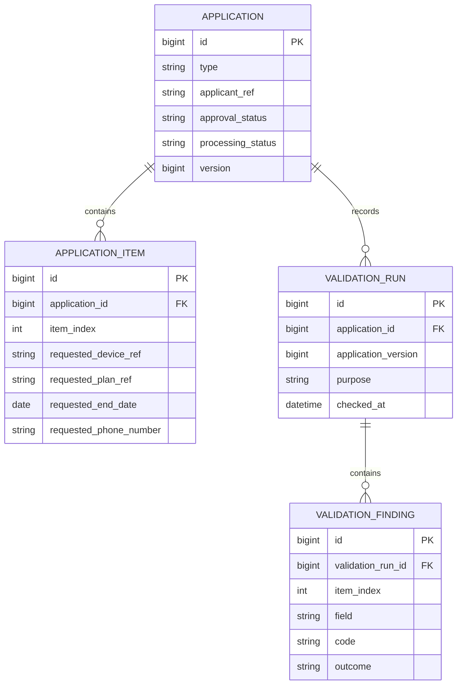

# 첫날 실행 패킷: 신청 구조와 Collect-All 검증

> 검토용 제안. 기준: main `69725bf44ad4a066724192383397dbd2e5f7e61b`.
> 기존 기획/ADR을 구현 가능한 작은 작업으로 나눈 문서이며, 구현 완료나 확정된 전체 ERD를 의미하지 않는다.
> 예시 값과 데이터는 모두 가상이다.

## 1. 확인한 현재 상태

- README, 기획 01~07, ADR 0001~0009가 있다.
- 08 ERD는 작성 중이다.
- 확인한 main에는 Java 소스, 빌드 설정, 실행 가능한 테스트가 없다.
- v0.1 목표는 신청 관리 + 검증 + 구조화된 오류다.
- 오늘 결과물: 신청/항목 관계 초안, 검증 입출력 계약 초안, 테스트 시나리오, 다음 구현 순서.
- 오늘 학습 완료 기준: 아래 설명 질문 3개에 자신의 말로 답하기. 전체 시스템 구현은 다음 단계다.

## 2. 빠르게 끝낼 수 있는 순서의 하루 계획

| 순서 | 작업 | 담당 | 예상 | 완료 기준 |
|---|---|---|---|---|
| 1 | 현재 파일과 구현 여부 확인 | 도우미 | 완료 | 위 현황을 저장소와 대조 |
| 2 | 오늘 범위와 이후 범위 분리 | 도우미 | 완료 | 신규 신청의 사전검증 한 흐름에 집중 |
| 3 | 설명 질문 읽기 | 작성자 | 5분 | 모르는 질문 하나 표시 |
| 4 | 가상 신청 사례를 표와 대조 | 작성자 | 10분 | 신청 1건/항목 5건 구분 |
| 5 | 관계·검증 계약·테스트 사례 초안 작성 | 도우미 | 완료 | 아래 초안을 검토 가능하게 제공 |
| 6 | 핵심 관계와 검증 흐름 설명 | 작성자 | 15분 | 질문 3개 답변 |
| 7 | 범위와 가정 검토 | 작성자 | 10분 | 동의 또는 수정 의견 기록 |
| 8 | Spring 프로젝트 셋업과 검증 구현 | 후속 작업 | 별도 산정 | 빌드 가능한 코드와 테스트 |

오늘 작성자 작업은 약 40분이다. 문서를 처음부터 다시 작성하지 않고, 초안에서 이해되지 않는 부분을 표시한다.

## 3. 신청과 항목: 부분 ERD 초안



이것은 첫 구현 흐름의 부분 ERD다. 기존 08 ERD를 대체하는 확정안이 아니다.
Line, Device, Plan, 호환 규칙, 첨부, 상태 이력, 외부 처리 기록은 전체 ERD에서 추가 설계한다.

### 관계와 제약 제안

- Application은 신청 전체를, ApplicationItem은 한 회선의 요청 내용을 나타낸다.
- 예: 가상 신청 APP-DEMO-001에 단말 DEMO-D01~DEMO-D05를 넣으면 신청 1건과 항목 5건이다.
- DRAFT는 입력 중이므로 항목 0개도 허용하는 제안이다. 제출 시 5~100개를 검사하는 제안은 기존 문서의 물량 설명을 정책으로 해석한 것이므로 확정이 필요하다.
- `application_item(application_id, item_index)`는 유일해야 한다. itemIndex는 초안에서 0부터 시작한다. 화면에는 +1하여 보여준다.
- 이 부분 ERD의 requested_* 값은 사용자가 입력한 원문이다. 존재하지 않는 단말/요금제도 오류를 알려주기 위해 입력 단계에서 받을 수 있다.
- 유효한 Device/Plan 마스터와 연결하는 FK는 전체 ERD에서 별도로 설계한다. 검증 전 요청 문자열을 마스터 FK로 바로 저장하면 DB 오류가 친절한 검증 응답보다 먼저 발생할 수 있다.
- 초안의 검증 이력은 신청 ID와 버전을 기록한다. 항목 수정 후에도 과거 itemIndex의 의미를 유지하려면 해당 버전의 입력 스냅샷 또는 불변 버전 항목 저장이 필요하다. 보존 범위/기간은 구현 전에 정한다.
- 오류 없는 검증도 ValidationRun은 남기고 Finding은 0건이다.
- 승인 상태와 처리 상태는 서로 다른 축이다. enum 전체 값과 매핑은 별도로 확정한다.
- 번호 변경은 새 Line과 이전 Line 링크로 표현한다(ADR-0005). 이 초안에 번호 PK를 도입하지 않는다.
- DB 트랜잭션으로 외부 LegacyProv의 처리까지 원자적으로 롤백할 수 있다고 가정하지 않는다. ADR-0003의 전체 반려는 신청 접수 단위이며 외부 처리 보상은 별도 설계다.

## 4. 첫 검증 계약 제안

경로와 오류 코드 이름은 신규 제안이다. 아직 실행 가능한 API가 아니다.

| 요청 | 역할 | 상태 변화 |
|---|---|---|
| POST /api/applications/{id}/validate | 저장된 DRAFT 현재 버전을 미리 검사 | DRAFT 유지, 검증 이력만 기록 가능 |
| POST /api/applications/{id}/submit | 현재 버전 재검증 후 전체 접수 | 오류 0건일 때만 DRAFT → SUBMITTED |

미리 검증한 뒤 단말 상태나 허용 요금제가 바뀔 수 있으므로 제출 때도 재검증한다.
동시 수정/제출은 버전 확인 또는 잠금으로 보호하고, 저장 트랜잭션 범위를 별도로 구현한다.
인증·신청 소유권 확인은 실제 API 노출 전에 필요하다.

### 이번 흐름에서 먼저 검사할 규칙

| 순서 | 조건 | 코드 제안 | 후속 검사 |
|---|---|---|---|
| 1 | 단말 참조값 누락 | DEVICE_REQUIRED | 해당 항목의 단말 존재·호환성 검사 생략 |
| 2 | 요금제 참조값 누락 | PLAN_REQUIRED | 해당 항목의 요금제 존재·호환성 검사 생략 |
| 3 | 신규 신청에 번호 직접 입력 | PHONE_NUMBER_NOT_ALLOWED | 독립된 다른 검사는 계속 |
| 4 | 단말 또는 요금제 미등록 | DEVICE_NOT_FOUND / PLAN_NOT_FOUND | 호환성 검사 생략 |
| 5 | 요금제 사용 불가 | PLAN_UNAVAILABLE | 유효한 선행 데이터가 있을 때 평가 |
| 6 | 단말 유형·요금제 비호환 | DEVICE_PLAN_INCOMPATIBLE | 마스터와 호환표를 바탕으로 평가 |

종료일 필수 여부, 신규 기간 제한, 항목 최소 수는 정책 확정 전 임의로 강화하지 않는다.
연장 최대 3개월의 기준일과 월말 계산은 연장 구현 전에 확정한다.
Collect-All은 가능한 독립 검사를 모두 수행한다는 뜻이다. 선행 값이 없어 수행 불가능한 검사는 SKIPPED로 구분한다(ADR-0002).

### 가상 실패 응답 예시

5개 항목 중 인덱스 0의 단말 누락, 인덱스 1의 요금제 누락,
인덱스 2의 번호 직접 입력만 잘못되고 나머지는 유효하다고 가정한다.

```json
{
  "applicationId": 1001,
  "applicationVersion": 0,
  "valid": false,
  "errors": [
    {"itemIndex": 0, "field": "deviceRef", "code": "DEVICE_REQUIRED", "message": "단말을 입력해 주세요."},
    {"itemIndex": 1, "field": "planRef", "code": "PLAN_REQUIRED", "message": "요금제를 입력해 주세요."},
    {"itemIndex": 2, "field": "phoneNumber", "code": "PHONE_NUMBER_NOT_ALLOWED", "message": "신규 신청에서는 번호를 직접 입력할 수 없습니다."}
  ],
  "skipped": [
    {"itemIndex": 0, "rule": "DEVICE_PLAN_COMPATIBILITY", "reason": "DEVICE_REQUIRED"},
    {"itemIndex": 1, "rule": "DEVICE_PLAN_COMPATIBILITY", "reason": "PLAN_REQUIRED"}
  ]
}
```

validate는 평가 결과를 200으로 반환하고, submit의 검증 실패는 422로 반환하는 제안이다.
DRAFT가 아닌 신청의 제출은 409로 구분한다. 최종 상태/HTTP 계약은 API 명세에서 확정한다.
위 skipped 목록은 호환성 검사 예시이며, 구현 시 생략된 존재 검사 등도 실제 규칙 목록에 맞게 기록한다.

## 5. 구현 후 실행할 수용 테스트 목록

아래는 테스트 설계이며 실행 결과가 아니다.

| 사례 | 기대 결과 |
|---|---|
| 유효한 가상 항목 5개 미리 검증 | valid=true, 오류 0, DRAFT 유지 |
| 위 예시처럼 독립 오류 3개 | 오류 3개를 한 응답에 반환, 각 itemIndex 정확 |
| 단말 누락 + 요금제 누락이 같은 항목에 존재 | 두 필수 오류 반환, 호환성은 SKIPPED, 예외 발생 없음 |
| 미등록 단말 참조 | DEVICE_NOT_FOUND, DB FK 예외 대신 도메인 오류 |
| 오류 항목 1개를 포함한 신청 제출 | 신청 전체 미접수, DRAFT 유지, 정상 항목도 부분 제출하지 않음 |
| 검증 통과 후 요금제 비활성화, 이어서 제출 | 제출 재검증에서 차단 |
| 정상 신청 제출 | SUBMITTED 전환 1회, 상태 이력 저장 |
| 동시 제출/중복 제출 | 중복 상태 변경·외부 결재 요청 방지; 세부 응답 계약 확정 후 검증 |
| 신청 수정 후 재검증 | 과거 검증 기록의 버전/항목 위치를 재구성할 수 있음 |

## 6. 다음 구현 순서

1. Java 21 + Spring 프로젝트, Gradle Wrapper, 최소 테스트 환경을 준비한다.
2. DB 없이 요청 DTO, ValidationError/ValidationResult, 검증 서비스를 먼저 만든다.
3. 위 Collect-All 단위 테스트로 오류 수집과 선행 검사 생략을 검증한다.
4. PostgreSQL 모델과 입력 버전/스냅샷 정책을 확정하고 마이그레이션을 작성한다.
5. 신청 저장 → validate → submit 흐름을 API로 연결하고 통합 테스트한다.
6. 이후 가상 ApprovalHub/LegacyProv 비교로 확장한다.

Redis, MSA, RAG, 배치, 자동 롤백은 첫 흐름의 선행 조건이 아니다.
기존 v0.1 계획의 세부 작업 순서 제안이며, 전체 MVP 완료 예상 기간을 단축했다는 뜻은 아니다.

## 7. 직접 설명할 질문 3개

1. 회선 5개를 신청할 때 Application 하나와 ApplicationItem 다섯 개로 나누는 이유는?
2. 검증 API가 성공했어도 제출 API에서 다시 검사해야 하는 이유는?
3. 단말 값이 없을 때 호환성 검사를 실행하면 어떤 문제가 생기고, 응답에 어떻게 나타내면 좋을까?

이해 확인의 기준은 코드 암기가 아니라 위 세 가지를 가상 신청 예시로 설명하는 것이다.

## 8. 검토할 가정과 남은 결정

- 제출 최소 항목 수 5가 강제 정책인지, 통상 물량 예시인지 확인.
- DRAFT 저장 시 필수값 누락 허용 범위와 원문/정규화된 마스터 참조의 분리.
- 승인 전 단말 예약 시점, 예약 충돌, 예약 해제 정책.
- 입력 스냅샷과 검증/상태 이력의 보존 기간.
- 완료/실패 상태와 사후 검증 실패·수동 에스컬레이션 상태의 대응.
- 기존 기획의 자동화 비율과 시간 절감 수치는 목표/가정이며 측정 성과로 표기하지 않는다.
